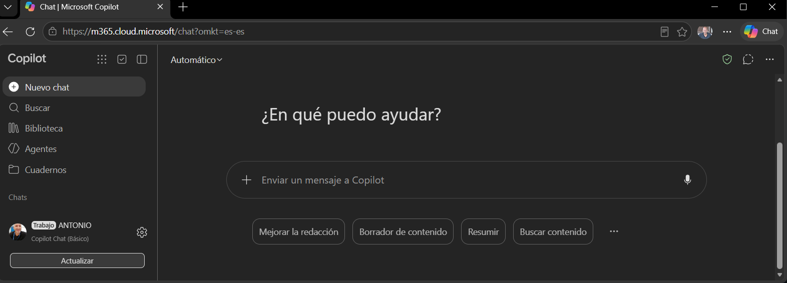
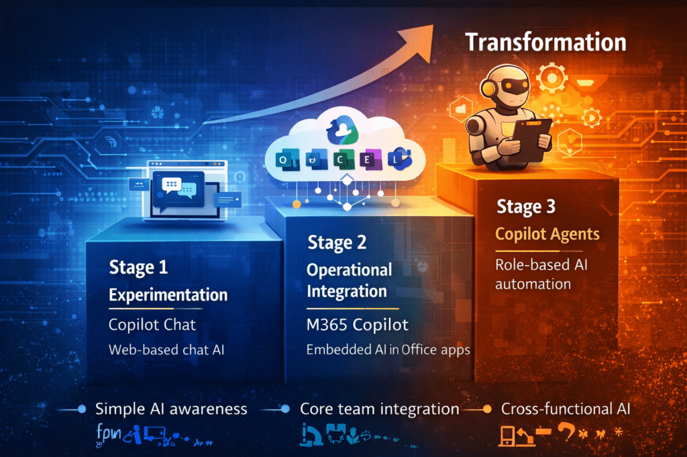
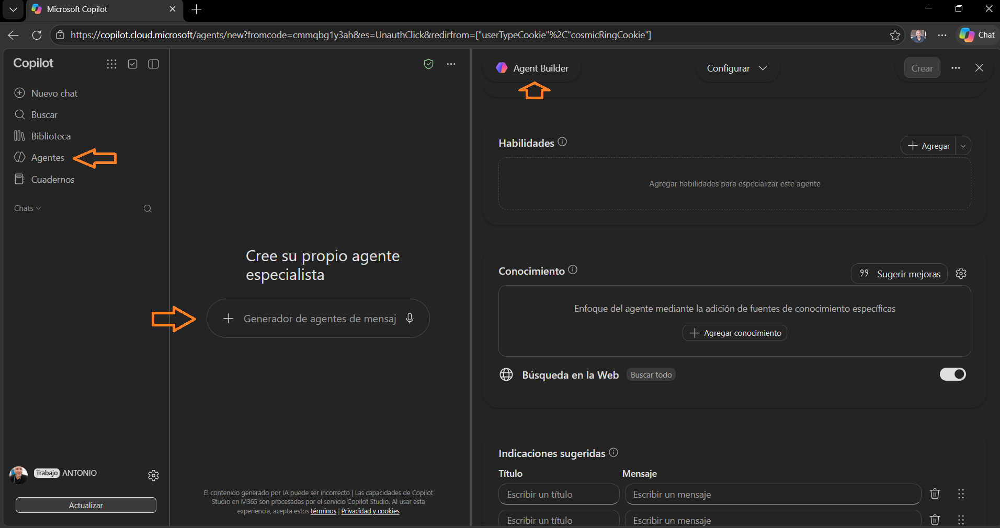

### Copilot Chat Office 365: uso básico y demostración práctica. Automatización de trabajos



<br clear="left">

> Explicación y uso fácil de **Copilot en Office 365 (Copilot Chat), sin licencia PRO**.

---

### Índice

0. [Introducción](#0-introducción)
   - [0.1 Uso de archivos de instrucciones: AGENTS.doc y SKILL.doc](#01-uso-de-archivos-de-instrucciones-agentsdoc-y-skilldoc)
1. [Trabajar con archivos en Copilot](#1-trabajar-con-archivos-en-copilot)
   - [1.0 Cargar ficheros desde OneDrive](#10-cargar-ficheros-desde-onedrive-paquete-office)
   - [1.1 Prompts básicos](#11-prompts-básicos-analizar-extraer-informes-resúmenes)
   - [1.2 Prompts e instrucciones reutilizables](#12-prompts-e-instrucciones-reutilizables)
   - [1.3 SKILL.doc y AGENTS.doc para automatizar tareas](#13-skilldoc-y-agentsdoc-para-automatizar-tareas)
   - [1.4 Plantilla de instrucciones para obtener un informe (formato de documento)](#14-plantilla-de-instrucciones-para-obtener-un-informe-formato-de-documento)
   - [1.5 Agentes instalados ya en Copilot](#15-agentes-instalados-ya-en-copilot)
2. [Seguridad y revisión de resultados](#2-seguridad-y-revisión-de-resultados)
   - [2.1 Detectar posibles errores o información inventada](#21-detectar-posibles-errores-o-información-inventada)
3. [Resumen final](#3-resumen-final)

---

### Agenda

| Bloque | Contenido | Tiempo |
|---|---|---|
| [0](#0-introducción) | Qué es Copilot sin licencia PRO y qué puede hacer | 5 min |
| [1.0](#10-cargar-ficheros-desde-onedrive-paquete-office) | Usar ficheros desde OneDrive: anexar, adjuntar, arrastrar | 5 min |
| [1.1](#11-prompts-básicos-analizar-extraer-informes-resúmenes) | Prompts básicos, consultas, instrucciones | 7 min |
| [1.2](#12-prompts-e-instrucciones-reutilizables) | Prompts reutilizables (PROMPT.txt) | 5 min |
| [1.3](#13-skilldoc-y-agentsdoc-para-automatizar-tareas) | Crear agentes en Copilot (automatización). Demo: crear 2 agentes | 10 min |
| [1.4](#14-plantilla-de-instrucciones-para-obtener-un-informe-formato-de-documento) | Informe de hacking automático con SKILL.doc y agente de Copilot | 5 min |
| [2](#2-seguridad-y-revisión-de-resultados) | Seguridad y revisión de resultados | 8 min |
| [3](#3-resumen-final) | Cierre: resumen y preguntas | 5 min |
| | **Total** | **≈ 50 min** |

---

### 0. Introducción

**Microsoft 365 Copilot Chat (sin licencia PRO de Microsoft 365 Copilot)** permite utilizar inteligencia artificial en tareas habituales de oficina, siempre dentro de las funcionalidades habilitadas por la empresa:

```text
¿Qué modelo de IA eres?
```

**Con respuesta rápida:**

1. **Consultas y búsquedas:** responder preguntas, resolver dudas, explicar conceptos y buscar información en Internet.
2. **Redacción y creación de contenido:** elaborar, corregir, resumir y traducir textos, correos, informes, propuestas y presentaciones.
3. **Análisis de documentos:** trabajar con archivos Word, Excel, PDF y PowerPoint adjuntos, extraer información, comparar documentos e identificar diferencias.
4. **Análisis de datos:** interpretar tablas, identificar tendencias, obtener conclusiones y elaborar recomendaciones.
5. **Prompts e instrucciones reutilizables:** utilizar plantillas, documentos de contexto y criterios predefinidos para estandarizar tareas y formatos de respuesta.
6. **OneDrive:** utilizar archivos corporativos accesibles, según los permisos y las funcionalidades habilitadas.

**Con razonamiento profundo:**

1. **Seguridad corporativa:** aplicar las políticas de protección de datos, acceso y seguridad establecidas por la organización.
2. **Programación y scripts:** generar, corregir, optimizar y explicar código en Python, Bash, PowerShell, JavaScript, SQL, etc.
3. **Ciberseguridad y vulnerabilidades:** analizar CVE y resultados de Nmap, Nessus y OpenVAS, identificar riesgos y proponer mitigaciones.
4. **Configuraciones de equipos:** revisar configuraciones de routers, switches, firewalls, VPN y servidores, detectando errores y problemas de seguridad.
5. **Archivos de configuración:** validar, corregir y generar JSON, YAML, XML, CSV, INI y otros formatos.
6. **Redes y protocolos:** analizar configuraciones de DNS, BGP, TLS, IPsec, HTTP, APIs y reglas de firewall.
7. **Logs y bases de datos:** analizar registros, detectar anomalías, generar consultas SQL y extraer información.
8. **Automatización y documentación:** crear procedimientos e informes técnicos, comparar configuraciones y reutilizar instrucciones mediante prompts.
9. **Imágenes y gráficos:** crear imágenes; se obtienen mejores resultados seleccionando el modelo GPT 5.6 Sol en modo razonamiento profundo.
10. **Presentaciones PowerPoint:** se obtienen mejores resultados seleccionando el modelo GPT 5.6 Sol en modo pensar (razonamiento profundo).

**Limitaciones:** sin la licencia completa de Microsoft 365 Copilot PRO, no se dispone de una integración avanzada y generalizada (Copilot - WORK) con Word, Excel, OneNote, Teams y SharePoint, ni de acceso automático a toda la información corporativa. Algunas funciones dependen de la configuración de la empresa, p.ej. Outlook.

```text
Haz una tabla comparativa ejecutiva de las diferencias principales de lo que NO permite la licencia corporativa actual de Copilot Chat O365 respecto a Copilot PRO.
```




### 0.1 Uso de archivos de instrucciones: AGENTS.doc y SKILL.doc

| # | Nombre de fichero | Descripción |
|---|---|---|
| 1 | `PROMPT.txt` | Fichero de texto con los prompts (instrucciones guardadas) utilizados en el proyecto. |
| 2 | `AGENTS.doc` | Documento con la definición/configuración de agentes (prompts o roles) para usar con Copilot. |
| 3 | `CVE_48h_Agente.doc` | Documento con la definición del agente que lista los CVE altos y críticos publicados en las últimas 48 h. |
| 4 | `agente_accion.docx` | Documento con la definición/configuración de agentes (prompts o roles) para usar con Copilot. |
| 5 | `SKILL.doc` | Documento que define una «skill» (habilidad) de Copilot, orientada a la generación de informes de pentest. |
| 6 | `cifrados.pdf` | Documento PDF sobre cifrados (algoritmos, técnicas o apuntes de criptografía). |
| 7 | `cve2026.txt` | Listado en texto de CVE (entradas del año 2026 u origen del script). |
| 8 | `cve2026.xls` | Hoja de cálculo con datos de CVE (tabla estructurada para análisis). |
| 9 | `hallazgos.xml` | Fichero XML con hallazgos de seguridad (resultados de análisis/pentest de FQDN). |
| 10 | `hallazgos2.xml` | Versión alternativa/actualizada de los hallazgos (resultados de análisis/pentest web). |
| 11 | `informe.doc` | Documento de informe (plantilla o ejemplo de informe de seguridad/pentest). |

Podremos utilizar ficheros de instrucciones en Microsoft 365 Copilot Chat:

1. `AGENTS.doc`: define instrucciones generales de trabajo para agentes de IA.
2. `SKILL.doc`: describe habilidades, tareas y procedimientos específicos.

Podemos adjuntarlos como documentos de referencia e indicarle que siga sus instrucciones en la sesión actual (se pueden anexar y usar un máximo de tres archivos por instrucción).

Como demostración práctica, cargaremos un archivo Excel con datos y un fichero `AGENTS.doc` con las especificaciones de trabajo, y le pediremos a Copilot: «Analiza el Excel siguiendo las instrucciones de AGENTS.doc y genera un informe con la estructura, los criterios y el formato especificados». De esta forma, demostraremos cómo utilizar instrucciones reutilizables para automatizar parcialmente tareas de análisis y generación de informes, sacándoles el máximo partido sin necesidad de una licencia adicional de Copilot, siempre que la configuración de la empresa permita adjuntar estos archivos.

---

### 1. Trabajar con archivos en Copilot

- **SharePoint:** almacenamiento en la nube para compartir datos en la empresa.
- **OneDrive:** almacenamiento en la nube para guardar datos personales.

### 1.0 Cargar ficheros desde OneDrive (paquete Office)

- Qué formatos se pueden usar: Word, Excel, PowerPoint, PDF y TXT.
- Cómo adjuntar un fichero desde OneDrive a la conversación de Copilot (carpeta /Home).
- Diferencia entre adjuntar un fichero, arrastrarlo y pegar texto en el chat.
- Límites habituales de la licencia Copilot Chat O365: tamaño de los ficheros y número de ficheros por conversación (máximo tres).
- **Demo:** cargar un documento de cada tipo, p. ej., un Word y un Excel de ejemplo.

### 1.1 Prompts básicos (analizar, extraer, informes, resúmenes)

Estructura recomendada de un buen prompt: **rol + tarea + contexto + formato de salida**.

```text
Word: informe.doc. Analiza este documento y genera un resumen ejecutivo, en un párrafo muy breve, usando lenguaje profesional orientado a dirección.
```

```text
Excel: cve2026.xls. Filtra las vulnerabilidades de SSH de 2026 con gravedad crítica y genera una tabla de dos columnas: una con el CVE y otra con la descripción.
```

```text
PDF: cifrados.pdf. Analiza el informe y haz una tabla como resumen ejecutivo con los protocolos y cifrados recomendados/seguros para HTTPS.
```

### 1.2 Prompts e instrucciones reutilizables

- Guardar los prompts que funcionan en un fichero propio (`PROMPT.txt`) para reutilizarlos.
- Usar marcadores sustituibles: `[PDF]`, `[Word]`, `[Excel]`...
- Opciones de reutilización en Copilot: biblioteca de prompts y copiar/pegar desde fichero.

📝 [PROMPTS](https://github.com/hackingyseguridad/copilot/blob/main/PROMPT.txt)

Copia y reutiliza en Copilot los siguientes prompts:

```text
SKILL: este modelo de IA, ¿qué tipo de habilidades (SKILLs) tienes?
```
```text
SKILL: este modelo de IA, ¿tiene modos de «razonamiento extendido» o thinking?
```
```text
SKILL: este modelo de IA, ¿tiene habilidades (SKILLs) en: programación (Bash, Python, C, ...),
vulnerabilidades (CVE), scripts para pruebas de concepto (POC)
y scripts para explotar vulnerabilidades (exploits)?
```
```text
Lista las vulnerabilidades CVE críticas publicadas en las últimas 48 h.
```

### 1.3 SKILL.doc y AGENTS.doc para automatizar tareas

**Convertir en agentes**

- Qué es un `SKILL.doc`: instrucciones paso a paso para una tarea concreta.
- Qué es un `AGENTS.doc`: premisas, reglas generales y comportamiento esperado del asistente.
- Cómo usarlos en Copilot sin licencia PRO: adjuntar el fichero y pedir que siga sus instrucciones.
- Ejecutar varias tareas encadenadas y obtener un informe con formato fijo.

```text
Lee el fichero AGENTS.doc adjunto y aplica para esta sesión las instrucciones allí descritas.
```
```text
Lee el fichero SKILL.doc adjunto y entrega el informe resultante con el formato de informe indicado.
```
```text
sobre el fichero hallazgos.xml , carga y usa siguiendo las directrices de SKILL.doc AGENTS.doc
```


**Agentes: los convertimos en agentes persistentes en nuestro Copilot con el asistente Agent Builder**

- Con los ficheros `AGENTS.doc` y `SKILL.doc` podemos crear, con cada uno, un agente persistente en Copilot mediante el asistente, dejarlo guardado y compartirlo.

Usaremos el asistente **Agent Builder** para crear agentes de forma manual y automatizar lo que hace cada uno:

1.º Crearemos con el asistente de Copilot un agente usando como plantilla `AGENTS.doc` y lo llamaremos, p. ej., «Premisas».

2.º Crearemos con el asistente de Copilot un agente usando como plantilla `SKILL.doc` y lo llamaremos «Informe_Hacking».



<br clear="left">

**Agent Builder:** con nuestra licencia actual podemos usar Agent Builder en Microsoft 365 Copilot, que permite crear agentes sencillos basados en prompts y documentos.

**Copilot Studio**, en cambio, permite integrar APIs, MCP, bases de datos y flujos con Power Automate. Requiere licencias, permisos específicos y un diseño más cuidadoso.

### 1.4 Plantilla de instrucciones para obtener un informe (formato de documento)

Plantilla base reutilizable:

```text
Con el fichero hallazgos.xml y sobre cada caso de vulnerabilidad, rellena esta plantilla:
```

```markdown
# Informe: [TÍTULO]

## 1. Resumen ejecutivo
(máx. 5 líneas)

## 2. Hallazgos principales
(lista numerada)

## 3. Descripción y datos de la vulnerabilidad y cifras clave
(tabla)

## 4. Riesgos y recomendaciones
(lista priorizada)

## 5. Próximos pasos
(responsable y fecha)
```

- Pedir a Copilot que rellene esta plantilla con el contenido del fichero cargado.
- Exportar el resultado a Word, PDF o PowerPoint.
- **Demo:** generar un informe completo a partir de un fichero con esta plantilla.

Seleccionamos GPT 5.6 Sol en modo razonamiento profundo y anexamos/subimos los ficheros de hallazgos y `SKILL.doc`:

```text
Analiza los ficheros hallazgos.xml y hallazgos2.xml. Lee y usa las especificaciones y habilidades dadas en el fichero SKILL.doc y genera los informes finales; guárdalos en formato Word, con todas las evidencias, detalles y descripciones necesarios disponibles.
```

### 1.5 Agentes instalados ya en Copilot

Agentes declarativos especializados, disponibles en la licencia actual de Copilot:

| Agente | Qué hace |
|---|---|
| Workflows (Frontier) | Crea flujos de trabajo automatizados mediante lenguaje natural, sin programar. |
| Learning | Recomienda formación personalizada en IA y otras competencias profesionales. |
| Workforce Insights (Frontier) | Analiza información organizativa, equipos, empleados y competencias profesionales. |
| SharePoint list agent | Convierte información de conversaciones de Copilot en listas estructuradas de SharePoint. |
| Prompt Coach | Ayuda a redactar, corregir y optimizar prompts para obtener mejores resultados. |
| Idea Coach | Facilita lluvias de ideas, desarrolla propuestas y ayuda a planificar proyectos. |
| Writing Coach | Mejora la redacción, la claridad, la estructura y el tono de textos y documentos. |
| Learning Coach | Actúa como tutor interactivo para aprender y practicar nuevos temas. |

---

### 2. Seguridad y revisión de resultados

### 2.1 Detectar posibles errores o información inventada

- Qué son las «alucinaciones»: respuestas plausibles pero falsas.
- Señales de alerta: datos demasiado exactos, fuentes que no se pueden localizar y afirmaciones sin respaldo en el fichero.
- Técnicas de control:

```text
Indica en qué página o sección del documento se apoya cada afirmación.
Si algo no aparece en el documento, dilo explícitamente en lugar de suponerlo.
```

- **Demo:** pedir a Copilot que cite la fuente de cada dato y verificar uno de ellos.

---

### 3. Resumen final

1. Cargar el fichero desde OneDrive (carpeta /Home).
2. Pedir con un prompt claro: rol, tarea, contexto y formato.
3. Reutilizar prompts, `SKILL.doc` y plantillas.
4. Usar solo herramientas autorizadas y respetar la clasificación de la información.
5. Revisar siempre el resultado antes de compartirlo.

---

[https://www.hackingyseguridad.com/](https://www.hackingyseguridad.com/)
