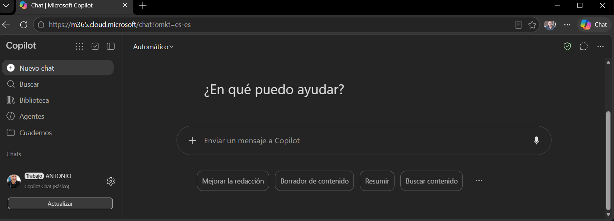

### Copilot Office 365: uso básico y demostración práctica

#



#

> Explicación y uso fácil de **Copilot en Office 365 (Copilot Chat), sin licencia PRO**.


### Índice

1. [Trabajar con archivos en Copilot](#1-trabajar-con-archivos-en-copilot)
   - [1.0 Cargar ficheros desde OneDrive](#10-cargar-ficheros-desde-onedrive-paquete-office)
   - [1.1 Prompts básicos](#11-prompts-básicos-analizar-extraer-informes-resúmenes)
   - [1.2 Prompts e instrucciones reutilizables](#12-prompts-e-instrucciones-reutilizables)
   - [1.3 SKILL.md y AGENTS.md para automatizar tareas](#13-skillmd-y-agentsmd-para-automatizar-tareas)
   - [1.4 Plantilla de instrucciones para informes](#14-plantilla-de-instrucciones-para-obtener-un-informe--formato-de-documento)
2. [Seguridad y revisión de resultados](#2-seguridad-y-revisión-de-resultados)
   - [2.0 Cuenta y herramientas autorizadas](#20-utilizar-la-cuenta-y-las-herramientas-autorizadas-por-la-empresa)
   - [2.1 Clasificación de la información](#21-comprobar-qué-información-se-puede-cargar-según-su-clasificación)
   - [2.2 Revisar antes de compartir](#22-revisar-cifras-interpretaciones-y-referencias-antes-de-compartir-un-informe)
   - [2.3 Detectar errores e información inventada](#23-detectar-posibles-errores-o-información-inventada)

---

### Agenda

| Bloque | Contenido | Tiempo |
|---|---|---|
| Introducción | Qué es Copilot sin licencia PRO y qué puede hacer | 2 min |
| 1.0 | Cargar ficheros desde OneDrive | 5 min |
| 1.1 | Prompts básicos | 7 min |
| 1.2 | Prompts reutilizables | 5 min |
| 1.3 | PROMPT.txt / AGENTS.docx / SKILL.docx | 7 min |
| 1.4 | Plantilla de informe | 5 min |
| 2.0 | Seguridad y revisión de resultados | 8 min |
| Cierre | Resumen y preguntas | 5 min |
| | **Total** | **≈ 45 min** |


---

### Introduccion:

**Microsoft 365 Copilot básico o corporativo con las funciones habilitadas por la empresa (sin licencia):** permite utilizar inteligencia artificial para realizar tareas habituales de oficina, como responder preguntas, resolver dudas, explicar conceptos, buscar información, redactar, corregir y traducir textos, resumir documentos, analizar archivos Word, Excel, PDF y PowerPoint (cuando esté habilitado), extraer información, generar informes, tablas, conclusiones y recomendaciones, utilizar prompts e instrucciones reutilizables para estandarizar tareas y formatos de respuesta, así como comparar documentos, identificar diferencias y extraer los puntos más relevantes.

Podremos utilizar ficheros de instrucciones en Microsoft 365 Copilot básico, como AGENTS.doc (convención abierta para definir instrucciones de trabajo dirigidas a agentes de IA), SKILL.doc (convención para describir habilidades o procedimientos específicos). Aunque Copilot básico no interpreta estos archivos automáticamente como configuraciones de agentes, podemos adjuntarlos como documentos de referencia e indicarle que siga sus instrucciones. Como demostración práctica, cargaremos un archivo Excel con datos y un fichero AGENTS.doc con las especificaciones de trabajo, solicitando a Copilot: «Analiza el Excel siguiendo las instrucciones de AGENTS.doc y genera un informe con la estructura, los criterios y el formato especificados». De esta forma, podremos demostrar cómo utilizar instrucciones reutilizables para automatizar parcialmente tareas de análisis y generación de informes, sin necesidad de una licencia adicional de Copilot, siempre que la configuración de la empresa permita adjuntar estos archivos.

### 1. Trabajar con archivos en Copilot

### 1.0 Cargar ficheros desde OneDrive (paquete Office)

- Qué formatos se pueden usar: Word, Excel, PowerPoint, PDF, .TXT.
- Cómo adjuntar un fichero desde OneDrive a la conversación de Copilot, caperta /Home.
- Diferencia entre adjuntar un fichero y pegar texto en el chat.
- Límites habituales: tamaño y número de ficheros por conversación.
- **Demo:** cargar un documento Word y un Excel de ejemplo.

### 1.1 Prompts básicos (analizar, extraer, informes, resúmenes)

Estructura recomendada de un buen prompt: **rol + tarea + contexto + formato de salida**.

```text
Word.: Analiza este documento y genera un resumen ejecutivo, en un parrafo breve muy breve y usa para ello lenguaje profesional orientado a dirección.
```

```text
Excel: filtra las vulnerabilidadespara SSH en 026 de gravedad alta o critica; Genera una tabla de dos columnas, una con el CVE y la otra columna con la descripción.
```

```text
pdf: analiza el informe y haz una tabla como resumen ejecutivo con los protocolos y cifrados recomendados / seguros , para HTTPS.
```

### 1.2 Prompts e instrucciones reutilizables

- Guardar los prompts que funcionan en un fichero propio (`PROMPT.txt`) para reutilizarlos.
- Usar marcadores sustituibles: `[pdf]`, `[Word]`, `[Excel]`..
- Opciones de reutilización en Copilot: biblioteca de prompts y copiar/pegar desde fichero.

```text
Copia y reutiliza en Copilot, el PROMTP necesario 
```

### 1.3 SKILL.md y AGENTS.md para automatizar tareas

- Qué es un `SKILL.doc`: instrucciones paso a paso para una tarea concreta.
- Qué es un `AGENTS.doc`: premisas, reglas generales y comportamiento esperado del asistente.
- Cómo usarlos en Copilot sin licencia PRO: adjuntar el fichero y pedir que siga sus instrucciones.
- Ejecutar varias tareas encadenadas y obtener un informe con formato fijo.

```text
Lee el fichero AGENTS.doc adjunto y aplica para esta sesión sus instrucciones ahi descritas.
Lee el fichero SKILL.doc adjunto y entrega el informa resultado con el formato de informe indicado.
```

### 1.4 Plantilla de instrucciones para obtener un informe / formato de documento

Plantilla base reutilizable:

con el fichero de hallazgos.xml y sobre cada caso de vulnerabilidad, rellena esta plantilla : 

```markdown
# Informe: [TÍTULO]

## 1. Resumen ejecutivo
(máx. 5 líneas)

## 2. Hallazgos principales
(lista numerada)

## 3. Descripción y datos de la vulnerabiliad  y cifras clave
(tabla)

## 4. Riesgos y recomendaciones
(lista priorizada)

## 5. Próximos pasos
(responsable y fecha)
```

- Pedir a Copilot que rellene esta plantilla con el contenido del fichero cargado.
- Exportar el resultado a Word, PDF o a PowerPoint.
- **Demo:** generar un informe completo a partir de un fichero con esta plantilla.

---

### 2. Seguridad y revisión de resultados

### 2.0 Utilizar la cuenta y las herramientas autorizadas por la empresa

- Usar siempre la cuenta corporativa de Office 365, nunca cuentas personales.
- Usar solo las herramientas de IA aprobadas por la organización.
- Comprobar que la sesión muestra la protección de datos corporativa activa.

### 2.1 Comprobar qué información se puede cargar según su clasificación

- Revisar la política de clasificación de la empresa (pública, interna, confidencial, restringida).
- No cargar datos personales, credenciales, secretos ni información sensible no autorizada.
- Ante la duda, anonimizar o consultar con el responsable de seguridad.

### 2.2 Revisar cifras, interpretaciones y referencias antes de compartir un informe

- Contrastar las cifras con el fichero original.
- Verificar que la interpretación se corresponde con el contenido real del documento.
- Comprobar que las referencias y citas existen y dicen lo que Copilot afirma.
- Revisión humana siempre antes de enviar o publicar.

### 2.3 Detectar posibles errores o información inventada

- Qué son las "alucinaciones": respuestas plausibles pero falsas.
- Señales de alerta: datos demasiado exactos, fuentes que no se pueden localizar, afirmaciones sin respaldo en el fichero.
- Técnicas de control:

```text
Indica en qué página o sección del documento se apoya cada afirmación.
Si algo no aparece en el documento, dilo explícitamente en lugar de suponerlo.
```

- **Demo:** pedir a Copilot que cite la fuente de cada dato y verificar uno de ellos.

---

### Resumen final

1. Cargar el fichero desde OneDrive (carpeta /home).
2. Pedir con un prompt claro: rol, tarea, contexto y formato.
3. Reutilizar prompts, `SKILL.md` y plantillas.
4. Usar solo herramientas autorizadas y respetar la clasificación de la información.
5. Revisar siempre el resultado antes de compartirlo.


#
http://www.hackingyseguridad.com/
#
