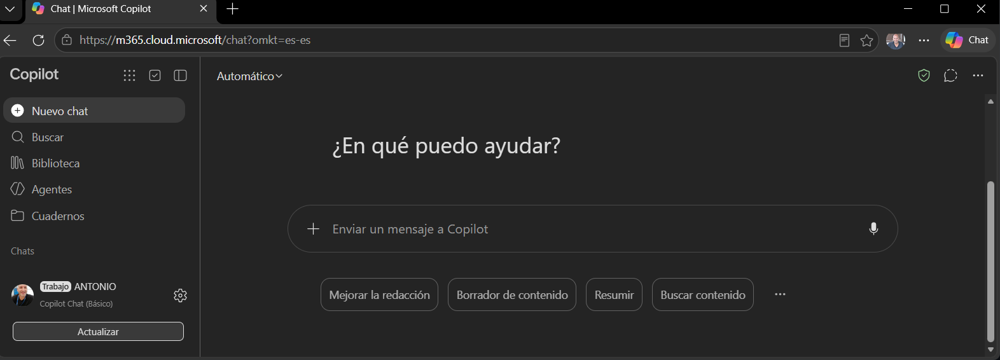

### Copilot Chat Office 365: uso básico y demostración práctica. Automatización de trabajos



<br clear="left">

> Explicación y uso fácil de **Copilot en Office 365 (Copilot Chat), sin licencia PRO**.

---

### Índice

0. [Introducción](#0-introducción)
   - [0.1 Uso de archivos de instrucciones: AGENTS.doc y SKILL.doc](#01-uso-de-archivos-de-instrucciones-agentsdoc-y-skilldoc)
1. [Trabajar con archivos en Copilot](#1-trabajar-con-archivos-en-copilot)
   - [1.0 Cargar ficheros desde OneDrive](#10-cargar-ficheros-desde-onedrive-paquete-office)
   - [1.1 Prompts básicos](#11-prompts-básicos-analizar-extraer-informes-resúmenes)
   - [1.2 Prompts e instrucciones reutilizables](#12-prompts-e-instrucciones-reutilizables)
   - [1.3 SKILL.doc y AGENTS.doc para automatizar tareas](#13-skilldoc-y-agentsdoc-para-automatizar-tareas)
   - [1.4 Plantilla de instrucciones para obtener un informe (formato de documento)](#14-plantilla-de-instrucciones-para-obtener-un-informe-formato-de-documento)
   - [1.5 Agentes instalados ya en Copilot](#15-agentes-instalados-ya-en-copilot)
2. [Seguridad y revisión de resultados](#2-seguridad-y-revisión-de-resultados)
   - [2.1 Detectar posibles errores o información inventada](#21-detectar-posibles-errores-o-información-inventada)
3. [Resumen final](#3-resumen-final)

---

### Agenda

| Bloque | Contenido | Tiempo |
|---|---|---|
| [0](#0-introducción) | Qué es Copilot sin licencia PRO y qué puede hacer | 5 min |
| [1.0](#10-cargar-ficheros-desde-onedrive-paquete-office) | Usar ficheros desde OneDrive: anexar, adjuntar, arrastrar | 5 min |
| [1.1](#11-prompts-básicos-analizar-extraer-informes-resúmenes) | Prompts básicos, consultas, instrucciones | 7 min |
| [1.2](#12-prompts-e-instrucciones-reutilizables) | Prompts reutilizables (PROMPT.txt) | 5 min |
| [1.3](#13-skilldoc-y-agentsdoc-para-automatizar-tareas) | Crear agentes en Copilot (automatización). Demo: crear 2 agentes | 10 min |
| [1.4](#14-plantilla-de-instrucciones-para-obtener-un-informe-formato-de-documento) | Informe de hacking automático con SKILL.doc y agente de Copilot | 5 min |
| [2](#2-seguridad-y-revisión-de-resultados) | Seguridad y revisión de resultados | 8 min |
| [3](#3-resumen-final) | Cierre: resumen y preguntas | 5 min |
| | **Total** | **≈ 50 min** |

---

### 0. Introducción

**Microsoft 365 Copilot Chat (sin licencia PRO de Microsoft 365 Copilot)** permite utilizar inteligencia artificial en tareas habituales de oficina, siempre dentro de las funcionalidades habilitadas por la empresa:

```text
¿Qué modelo de IA eres?
```

**Con respuesta rápida:**

1. **Consultas y búsquedas:** responder preguntas, resolver dudas, explicar conceptos y buscar información en Internet.
2. **Redacción y creación de contenido:** elaborar, corregir, resumir y traducir textos, correos, informes, propuestas y presentaciones.
3.
@antonio_taboada
