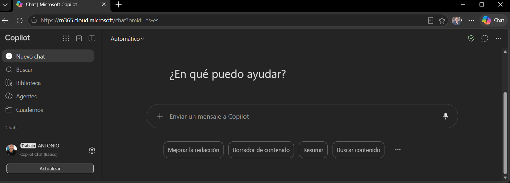

# Copilot Office 365: uso básico y demostración práctica

[](http://hackingyseguridad.com/)

> Guía práctica para usar **Microsoft 365 Copilot Chat sin licencia de pago (PRO)**: cómo trabajar con ficheros, reutilizar instrucciones y revisar los resultados con seguridad.

---

## Índice

1. [Trabajar con archivos en Copilot](#1-trabajar-con-archivos-en-copilot)
   - [1.0 Cargar ficheros desde OneDrive](#10-cargar-ficheros-desde-onedrive-paquete-office)
   - [1.1 Prompts básicos](#11-prompts-básicos-analizar-extraer-informes-y-resúmenes)
   - [1.2 Prompts e instrucciones reutilizables](#12-prompts-e-instrucciones-reutilizables)
   - [1.3 SKILL y AGENTS para automatizar tareas](#13-skill-y-agents-para-automatizar-tareas)
   - [1.4 Plantilla de instrucciones para informes](#14-plantilla-de-instrucciones-para-obtener-un-informe)
2. [Seguridad y revisión de resultados](#2-seguridad-y-revisión-de-resultados)
   - [2.0 Cuenta y herramientas autorizadas](#20-utilizar-la-cuenta-y-las-herramientas-autorizadas-por-la-empresa)
   - [2.1 Clasificación de la información](#21-comprobar-qué-información-se-puede-cargar-según-su-clasificación)
   - [2.2 Revisar antes de compartir](#22-revisar-cifras-interpretaciones-y-referencias-antes-de-compartir-un-informe)
   - [2.3 Detectar errores e información inventada](#23-detectar-errores-o-información-inventada)
3. [Resumen final](#resumen-final)

---

## Agenda

| Bloque       | Contenido                                          | Tiempo       |
|--------------|----------------------------------------------------|--------------|
| Introducción | Qué es Copilot sin licencia PRO y qué puede hacer  | 2 min        |
| 1.0          | Cargar ficheros desde OneDrive                     | 5 min        |
| 1.1          | Prompts básicos                                    | 7 min        |
| 1.2          | Prompts reutilizables                              | 5 min        |
| 1.3          | `PROMPT.txt`, `AGENTS.docx` y `SKILL.docx`         | 7 min        |
| 1.4          | Plantilla de informe                               | 5 min        |
| 2            | Seguridad y revisión de resultados                 | 8 min        |
| Cierre       | Resumen y preguntas                                | 5 min        |
|              | **Total**                                          | **≈ 45 min** |

---

## Introducción

**Microsoft 365 Copilot básico (o corporativo, con las funciones que la empresa tenga habilitadas) permite usar inteligencia artificial en las tareas habituales de oficina, sin necesidad de licencia adicional.**

Con él se puede:

- Responder preguntas, resolver dudas, explicar conceptos y buscar información.
- Redactar, corregir y traducir textos.
- Resumir y analizar documentos Word, Excel, PDF y PowerPoint (si la empresa lo permite).
- Extraer información y generar informes, tablas, conclusiones y recomendaciones.
- Comparar documentos e identificar diferencias y puntos relevantes.
- Estandarizar tareas y formatos de respuesta con prompts e instrucciones reutilizables.

### Ficheros de instrucciones: `AGENTS` y `SKILL`

Copilot básico admite ficheros de instrucciones como documentos de referencia:

- **`AGENTS`**: convención abierta para definir las reglas de trabajo dirigidas a agentes de IA.
- **`SKILL`**: convención para describir una habilidad o un procedimiento concreto.

Copilot básico **no los interpreta automáticamente** como configuración de un agente. Basta con adjuntarlos a la conversación e indicarle que siga sus instrucciones.

### Demostración práctica

Cargaremos un Excel con datos y un fichero `AGENTS` con las especificaciones de trabajo, y pediremos a Copilot:

> «Analiza el Excel siguiendo las instrucciones de AGENTS y genera un informe con la estructura, los criterios y el formato especificados.»

Así se automatiza parcialmente el análisis y la generación de informes sin licencia adicional, siempre que la configuración de la empresa permita adjuntar estos archivos.

---

## 1. Trabajar con archivos en Copilot

### 1.0 Cargar ficheros desde OneDrive (paquete Office)

- **Formatos admitidos:** Word, Excel, PowerPoint, PDF y TXT.
- **Cómo adjuntar:** desde OneDrive (carpeta `/Home`) a la conversación de Copilot.
- **Adjuntar o pegar:** conviene conocer la diferencia entre adjuntar un fichero y pegar su texto en el chat.
- **Límites habituales:** tamaño de cada fichero y número de ficheros por conversación.
- **Demo:** cargar un documento Word y un Excel de ejemplo.

### 1.1 Prompts básicos: analizar, extraer, informes y resúmenes

Estructura recomendada de un buen prompt: **rol + tarea + contexto + formato de salida**.

**Word**

```
Analiza este documento y genera un resumen ejecutivo en un párrafo muy breve, con lenguaje profesional orientado a dirección.
```

**Excel**

```
Filtra las vulnerabilidades de SSH de 2026 con gravedad alta o crítica. Genera una tabla de dos columnas: CVE y descripción.
```

**PDF**

```
Analiza el informe y elabora una tabla como resumen ejecutivo con los protocolos y cifrados recomendados (seguros) para HTTPS.
```

### 1.2 Prompts e instrucciones reutilizables

- Guarda los prompts que funcionan en un fichero propio (`PROMPT.txt`) para reutilizarlos.
- Usa marcadores sustituibles según el tipo de documento: `[PDF]`, `[Word]`, `[Excel]`…
- Opciones de reutilización en Copilot: la biblioteca de prompts o copiar y pegar desde el fichero.

```
Copia y pega en Copilot el prompt que necesites desde PROMPT.txt.
```

### 1.3 SKILL y AGENTS para automatizar tareas

- **`SKILL`**: instrucciones paso a paso para una tarea concreta.
- **`AGENTS`**: premisas, reglas generales y comportamiento esperado del asistente.
- **Uso sin licencia PRO:** adjunta el fichero y pide a Copilot que siga sus instrucciones.
- Se pueden encadenar varias tareas y obtener un informe con formato fijo.

```
Lee el fichero AGENTS adjunto y aplica en esta sesión las instrucciones que contiene.
Lee el fichero SKILL adjunto y entrega el informe resultante con el formato indicado.
```

### 1.4 Plantilla de instrucciones para obtener un informe

Plantilla base reutilizable:

```
# Informe: [TÍTULO]

## 1. Resumen ejecutivo
(máx. 5 líneas)

## 2. Hallazgos principales
(lista numerada)

## 3. Datos y cifras clave
(tabla)

## 4. Riesgos y recomendaciones
(lista priorizada)

## 5. Próximos pasos
(responsable y fecha)
```

- Pide a Copilot que rellene la plantilla con el contenido del fichero cargado.
- Exporta el resultado a Word o PowerPoint.
- **Demo:** generar un informe completo a partir de un fichero con esta plantilla.

---

## 2. Seguridad y revisión de resultados

### 2.0 Utilizar la cuenta y las herramientas autorizadas por la empresa

- Usa siempre la cuenta corporativa de Office 365, nunca cuentas personales.
- Utiliza solo las herramientas de IA aprobadas por la organización.
- Comprueba que la sesión muestra la protección de datos corporativa activa.

### 2.1 Comprobar qué información se puede cargar según su clasificación

- Revisa la política de clasificación de la empresa (pública, interna, confidencial, restringida).
- No cargues datos personales, credenciales, secretos ni información sensible no autorizada.
- Ante la duda, anonimiza los datos o consulta con el responsable de seguridad.

### 2.2 Revisar cifras, interpretaciones y referencias antes de compartir un informe

- Contrasta las cifras con el fichero original.
- Verifica que la interpretación se corresponde con el contenido real del documento.
- Comprueba que las referencias y citas existen y dicen lo que Copilot afirma.
- Realiza siempre una revisión humana antes de enviar o publicar.

### 2.3 Detectar errores o información inventada

- **Alucinaciones:** respuestas plausibles pero falsas.
- **Señales de alerta:** datos demasiado exactos, fuentes imposibles de localizar o afirmaciones sin respaldo en el fichero.
- **Técnica de control:**

```
Indica en qué página o sección del documento se apoya cada afirmación.
Si algo no aparece en el documento, dilo explícitamente en lugar de suponerlo.
```

- **Demo:** pedir a Copilot que cite la fuente de cada dato y verificar uno de ellos.

---

## Resumen final

1. Carga el fichero desde OneDrive (carpeta `/Home`).
2. Escribe un prompt claro: rol, tarea, contexto y formato.
3. Reutiliza prompts, `SKILL`, `AGENTS` y plantillas.
4. Usa solo herramientas autorizadas y respeta la clasificación de la información.
5. Revisa siempre el resultado antes de compartirlo.

---

🌐 [hackingyseguridad.com](http://www.hackingyseguridad.com/)
